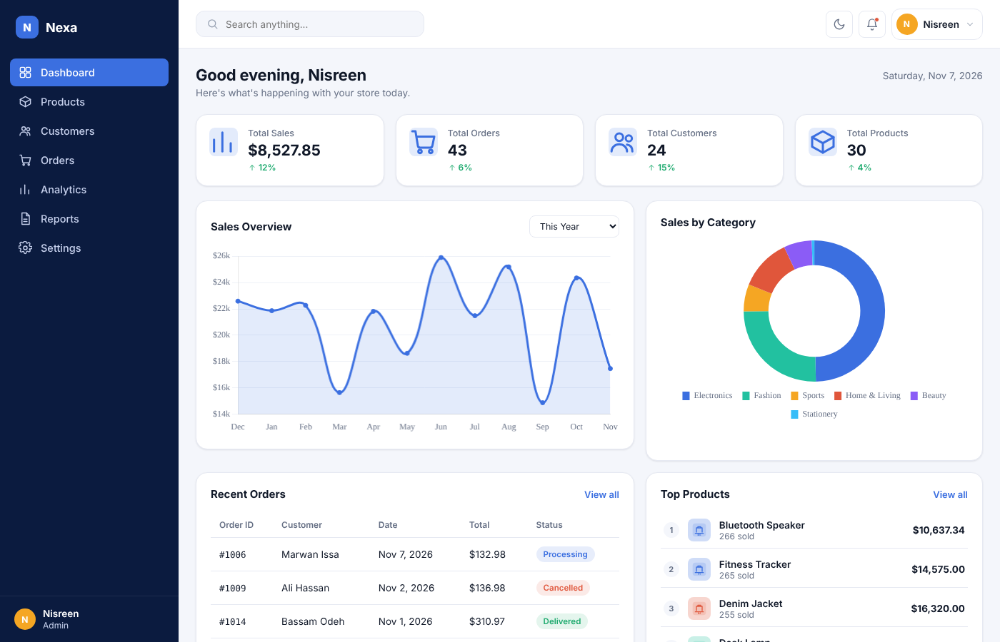
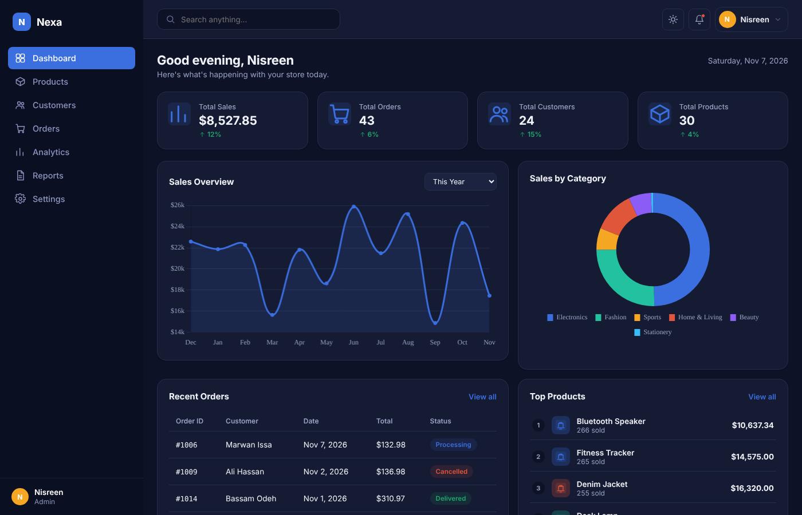
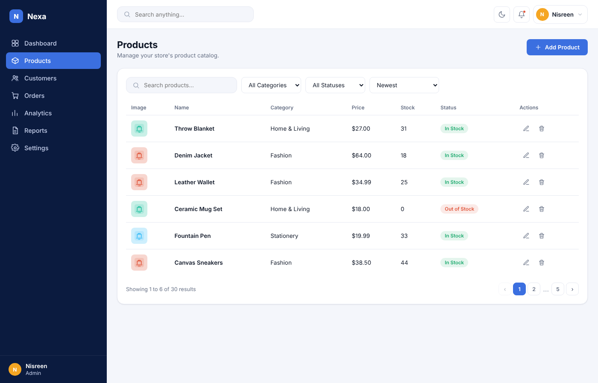
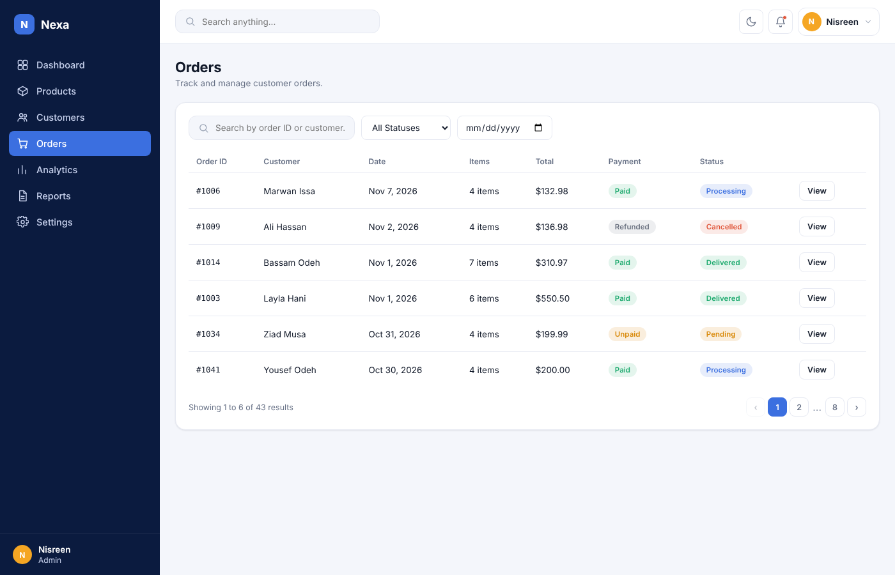
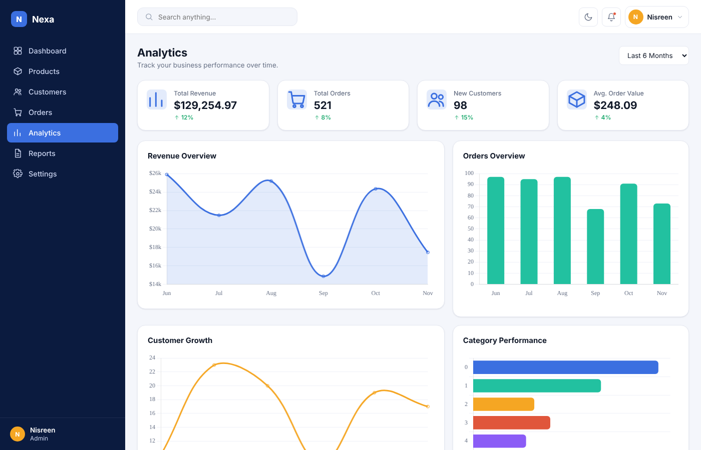
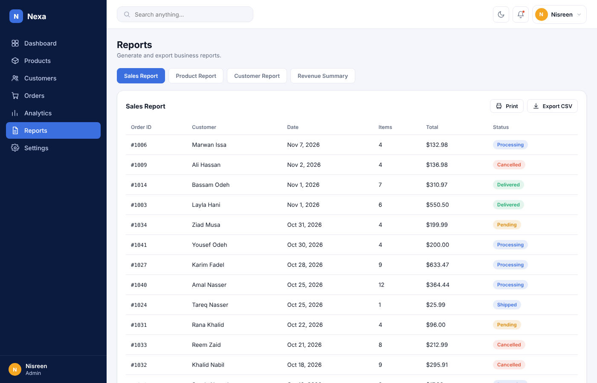
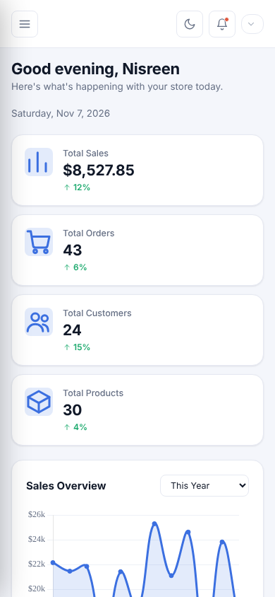

# Nexa Business Dashboard

A complete, frontend-only Business Management Dashboard built with **HTML5, CSS3, and vanilla JavaScript (ES6+)**. Nexa simulates a real SaaS-style admin panel for managing products, customers, orders, analytics, and reports — with realistic mock data, full CRUD interactions, and persistence via `localStorage`.

> This is a **frontend-only portfolio project**. There is no backend, database, or API — all data is mock data generated in JavaScript and stored in the browser's `localStorage`.

## Features

- **Dashboard** — revenue, sales, customer and product KPIs, monthly sales chart, sales-by-category chart, recent orders, top products, and a performance summary.
- **Products** — searchable, filterable, sortable, paginated product table with add / edit / delete modals and automatic stock-status calculation.
- **Customers** — customer directory with search, status filtering, sorting, pagination, and add / edit / delete flows.
- **Orders** — order list with search, status and date filtering, pagination, and an order detail modal with inline status updates.
- **Analytics** — date-range driven revenue, orders, customer growth and category performance charts with summary stats.
- **Reports** — tabbed Sales / Product / Customer / Revenue reports with CSV export and a print-friendly layout.
- **Settings** — profile, business information, notification preferences, and light/dark appearance settings.
- Fully responsive across desktop, tablet, and mobile (375px–1920px), with a collapsible mobile sidebar.
- Toast notifications, confirmation dialogs, empty states, and form validation throughout.
- Light / dark theme toggle, persisted across sessions.
- Currency symbol follows the currency chosen in Settings → Business Info (USD, EUR, GBP, ILS, JOD).
- All changes (add/edit/delete, settings, theme) persist after refresh via `localStorage`.

## Technologies

- HTML5 (semantic markup)
- CSS3 (custom properties / design tokens, Flexbox, Grid, no framework)
- Vanilla JavaScript (ES6+, no frameworks or build tools)
- [Chart.js](https://www.chartjs.org/) — **vendored locally** at `js/vendor/chart.umd.min.js` (no external CDN dependency, so charts always work even offline or on restricted networks)
- Google Fonts (Plus Jakarta Sans, JetBrains Mono) via CDN — optional; the UI falls back to system fonts if this can't load
- Avatars come from `i.pravatar.cc` — optional; if offline, an initials badge is shown instead

No React, Vue, Angular, TypeScript, Node.js, or backend of any kind is used.

## Screenshots

| Dashboard (light) | Dashboard (dark) |
| --- | --- |
|  |  |

| Products | Orders |
| --- | --- |
|  |  |

| Analytics | Reports |
| --- | --- |
|  |  |

**Mobile (390px)**



## How to Run

This project requires no build step or installation.

1. Download or clone this repository.
2. Open `index.html` directly in your browser, **or**
3. Serve it with a simple local server (recommended for consistent behavior), e.g. the VS Code "Live Server" extension, or:

   ```bash
   npx serve .
   # or
   python -m http.server 8080
   ```

4. Navigate to the served URL (e.g. `http://localhost:8080`).

## Project Structure

```
nexa-business-dashboard/
│
├── index.html
├── css/
│   └── style.css
│
├── js/
│   ├── vendor/
│   │   └── chart.umd.min.js  # Chart.js, bundled locally (no CDN dependency)
│   ├── icons.js         # inline SVG icon set
│   ├── data.js           # mock data + localStorage persistence
│   ├── app.js             # shell: routing, theme, toasts, modals, helpers
│   ├── dashboard.js
│   ├── products.js
│   ├── customers.js
│   ├── orders.js
│   ├── analytics.js
│   ├── reports.js
│   └── settings.js
│
├── assets/
│   ├── images/products/   # product SVG illustrations
│   └── screenshots/       # images used in this README
│
└── README.md
```

## Data & Persistence Notes

- All data lives in `localStorage` under a single key (see `STORAGE_KEY` in `js/data.js`). To reset the demo to its original mock data, clear the site's `localStorage` (DevTools → Application → Local Storage → delete the key) and refresh.
- Mock data is generated from a seeded random generator, so it is the same on every fresh load. Dashboard KPIs come from the order list, while the monthly charts use a separate 12-month revenue history, so their totals intentionally differ.
- The "Last 30 Days" range shows the current month only (monthly data granularity).
- Notification toggles and the logout action are UI-only (no real emails or authentication).

## Testing

The project was verified in a headless Chromium (Playwright): all 7 pages render with no JavaScript errors, and add / edit / delete flows, form validation, search, filters, sorting, pagination, order status updates, CSV export, theme switching, currency setting, `localStorage` persistence across reloads, and the mobile layout (375px, no horizontal page scroll) all pass.

## Future Improvements

- Connect to a real backend/API and database for persistent, multi-user data.
- Add authentication and role-based access control.
- Add drag-and-drop image upload for product photos.
- Add more granular analytics (cohort analysis, retention, LTV).
- Add unit tests for core JavaScript logic.
- Add internationalization (i18n) and multi-currency support.

## Author

Built as a portfolio project to demonstrate frontend architecture, UI/UX design, and vanilla JavaScript application development skills.
